# Restaurant POS

A self-hosted point of sale for a sit-down restaurant: floor plan, order taking, a kitchen display
with printed KOTs, billing with split payments, table reservations with advances, order history,
sales reports and automatic backups. It runs on one machine in the restaurant and every phone,
tablet or laptop on the Wi-Fi uses it in the browser.

There is no accounting ledger and no tax engine.

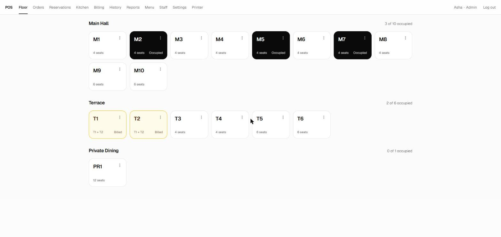

## Features

### Floor and tables
Rooms and tables at a glance: free, occupied, or billed and waiting for payment. From a table's
menu you can **join** tables for a large party, **split** them again, or **move** an order to another
table. Every screen updates live over websockets.

### Taking orders
Tap dishes to add them, search the menu or filter by category, and add a note for the kitchen.
Dishes with a **Jain** option ask Regular or Jain when added; a Jain portion gets its own line and
prints as `Dish (J)`. Unavailable dishes are greyed out. **Send to kitchen** sends only what changed
since the last send.

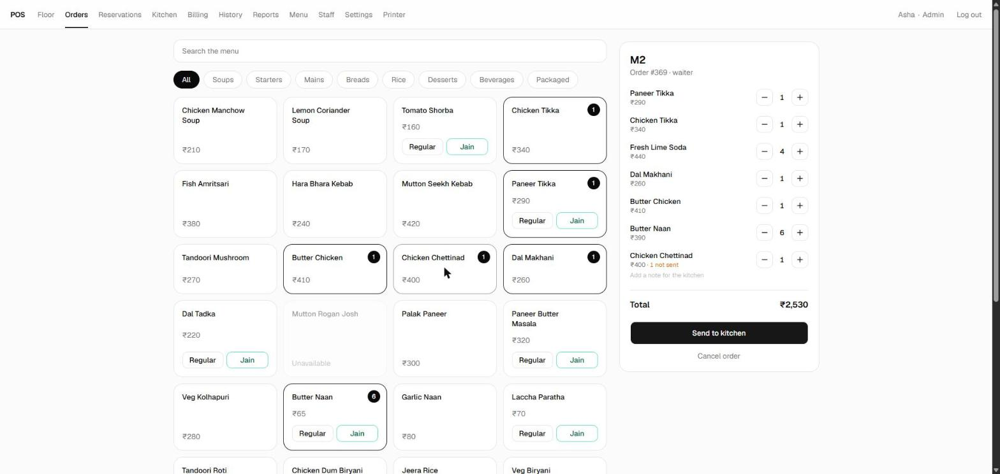

### Kitchen display and KOTs
Kitchen staff see one ticket per station (Tandoor, Main Kitchen, Bar…) and move it from **Start** to
**Ready** to **Served**. Add-ons, part-cancellations and cancellations get their own tickets, and Jain
lines are tagged. KOTs print on a thermal printer through [QZ Tray](https://qz.io). Any ticket can be
reprinted.

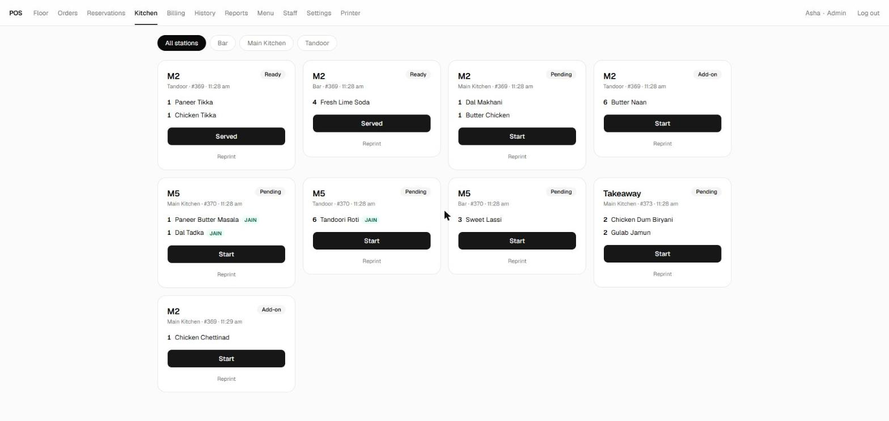

### Billing and payments
Bill with a discount as an amount or a percentage, then take payment by cash, card, UPI or other.
You can split a bill across methods or take it in part payments. A billed order can be reopened
until the first payment. Any reservation advance comes off the balance.

| Advance from a booking | Split payment |
|---|---|
| 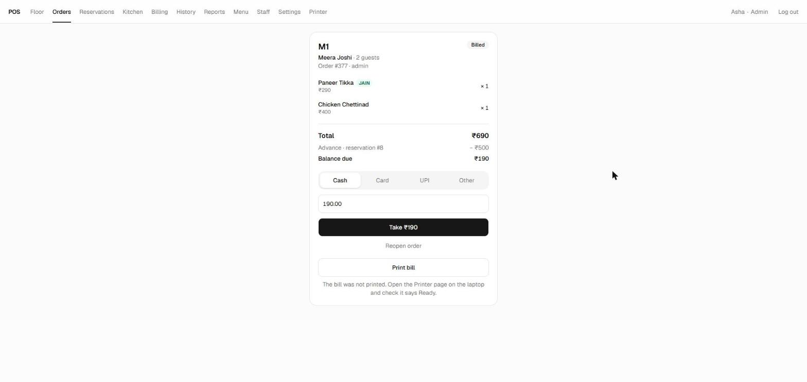 | 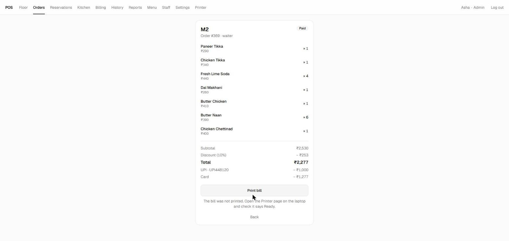 |

### Reservations
A day view (tables × time) and a month view. Book one or more tables, or a whole private room, with
the occasion, notes and an optional advance. **Double-booking is impossible** because the database
refuses overlapping bookings. **Seat party** joins the tables and opens an order that carries the
advance. On a cancellation or no-show, you refund the advance in full or in part, or keep it.

| Calendar | New booking |
|---|---|
| 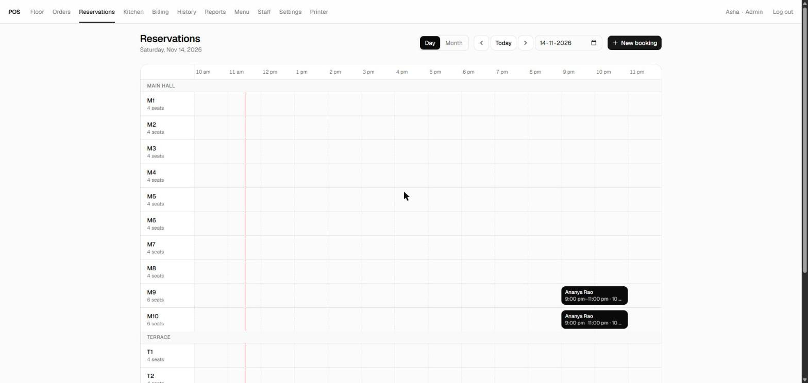 | 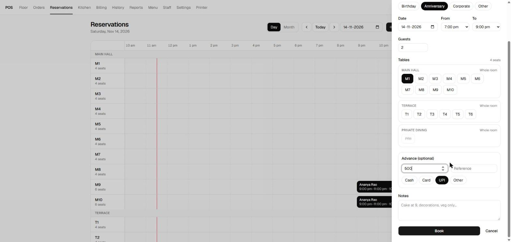 |

### Order history and reports
Search every order by number, customer name or phone, and filter by date, status, type or table.
Reports show sales, average bill, spend per guest, sales by day or hour, busy hours, best-selling
items (with Jain counts), categories, dine-in vs takeaway, money received by method, staff, and
cancellations.

| History | Reports |
|---|---|
| 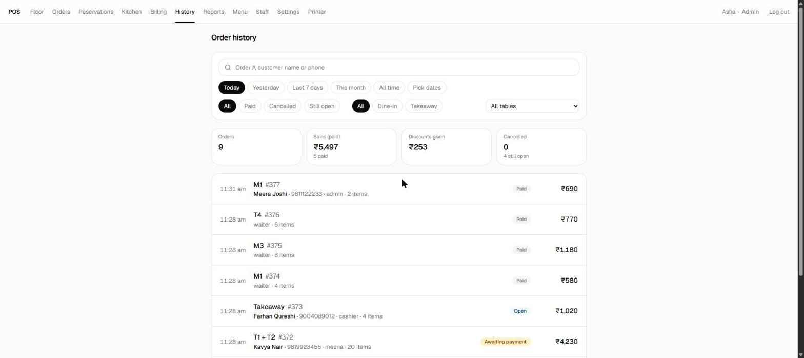 | 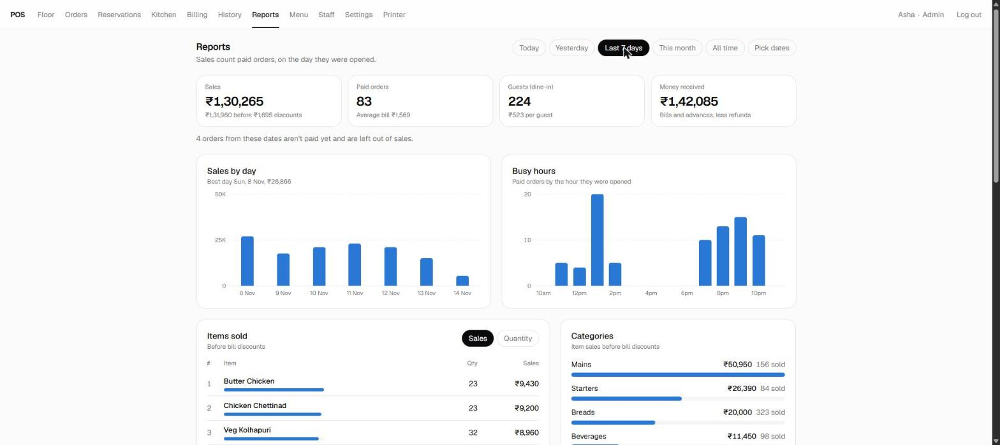 |

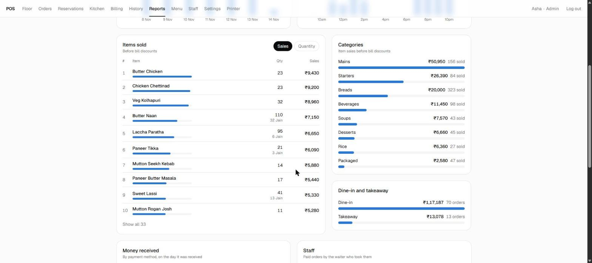

### Menu, staff and roles
Managers edit items, prices, photos, categories, courses and kitchen stations, and mark a dish
unavailable with one switch. Admins add staff and set their role. Five roles (Admin, Manager,
Cashier, Waiter, Kitchen) each see only their own screens; see [Roles](#roles).

| Menu | Staff |
|---|---|
| 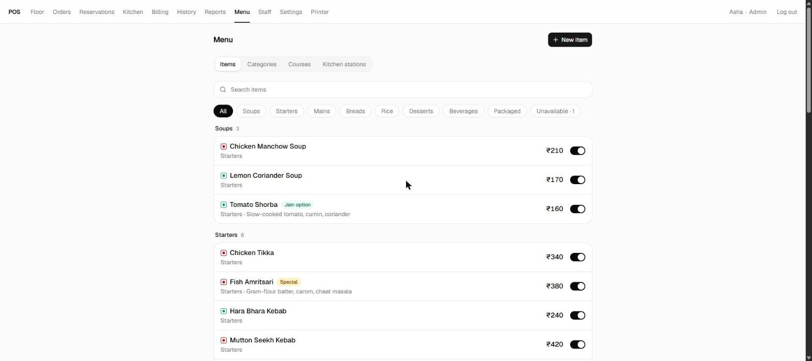 | 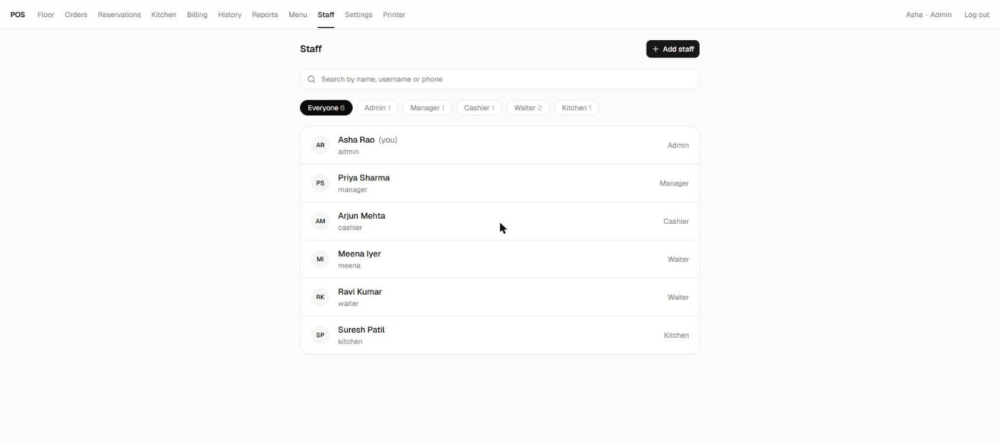 |

### Backups
Automatic backups on a schedule you set (default: every 3 hours, kept 7 days), plus a download
button. One zip holds everything, and it restores onto a new server from the setup screen or the
command line.

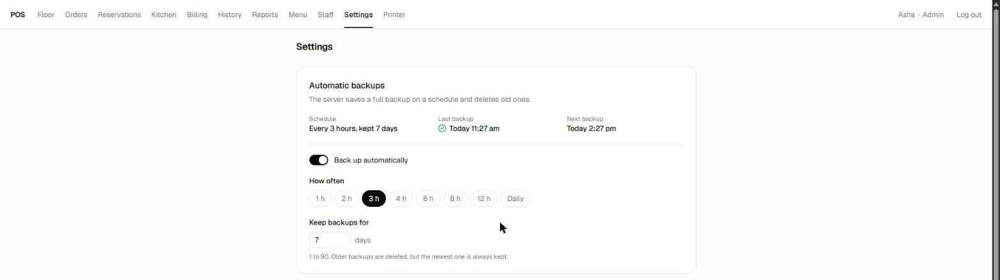

## Installation

### What you need

| | |
|---|---|
| [Docker](https://docs.docker.com/get-docker/) | runs Postgres 17 and Redis 7 |
| [uv](https://docs.astral.sh/uv/getting-started/installation/) | Python 3.12+ and the backend's packages |
| [Node 24](https://nodejs.org/) | builds the frontend (`nvm use` reads `frontend/.nvmrc`) |

### 1. Get the code and start the database

```bash
git clone https://github.com/rgrahul1998/restaurant-pos.git
cd restaurant-pos
docker compose up -d --wait          # Postgres on :5433, Redis on :6380
```

### 2. Backend

```bash
cd backend
cp .env.example .env                 # then set SECRET_KEY; see the comments in the file
uv sync
uv run python manage.py migrate
uv run python manage.py runserver    # API + websockets on :8000
```

In a second terminal, start the worker that runs automatic backups:

```bash
cd backend && uv run python manage.py backup_worker
```

### 3. Frontend

```bash
cd frontend
npm install
npm run dev                          # http://localhost:5173 (proxies /api, /ws, /media to :8000)
```

### 4. First-run setup

Open **http://localhost:5173**. On a new install with an empty database, the POS shows a setup
screen in place of sign-in:

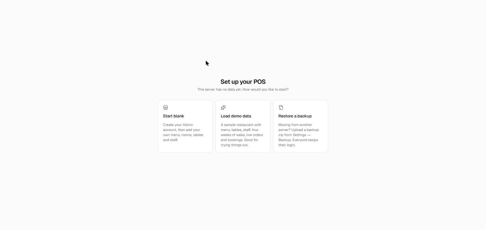

| Option | What you get |
|---|---|
| **Start blank** | Your Admin account and the restaurant name. Then add the menu (**Menu**), staff (**Staff**) and rooms and tables (Django admin, `/admin/`). |
| **Load demo data** | A sample restaurant, *Saffron Table*: 3 rooms and 17 tables, a 33-dish menu with Jain options, 5 staff (`manager`, `cashier`, `waiter`, `meena`, `kitchen`; all use the password you choose), four weeks of past sales, tables in service right now, and upcoming bookings. Good for training or trying things out. |
| **Restore a backup** | Upload a `pos-backup-….zip` from another server (**Settings → Backup**). Everything comes back, and everyone signs in with their old password. |

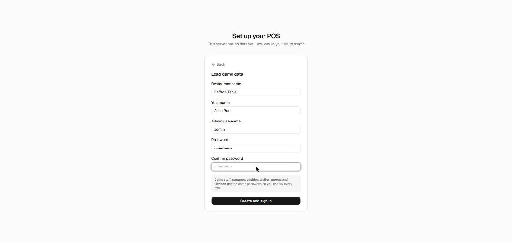

Setup is only offered while the database has no users. Once anyone exists, the screen and its API
refuse, so setup can't be used to take over a running POS.

The same choices from the command line, e.g. on a server:

```bash
uv run python manage.py setup_site --username admin --restaurant "My Restaurant"          # blank
uv run python manage.py setup_site --username admin --demo                                # demo data
uv run python manage.py restore_backup pos-backup-2026-11-14-2300.zip                     # restore
```

To start over on a development machine: `uv run python manage.py flush`, then reload the page.

### 5. Printing (optional)

KOTs and bills print on thermal printers connected to one laptop, through QZ Tray. Install
[QZ Tray](https://qz.io/download) on that laptop, check that each printer prints a test page, then
open **Printer** in the POS and pick the KOT and bill printers. See [Printing](#printing).

### Running it for real service

- In `backend/.env`, set `DEBUG=False`, a long random `SECRET_KEY`, and the address staff will type
  into `ALLOWED_HOSTS` and `CORS_ALLOWED_ORIGINS` (e.g. the server's LAN IP).
- Run the backend under Daphne (`uv run daphne -b 0.0.0.0 -p 8000 config.asgi:application`) and
  `backup_worker`, both as services (systemd or similar) so they restart with the machine.
- Build the frontend once (`npm run build`) and serve `frontend/dist/` with a web server that sends
  `/api`, `/ws`, `/media`, `/admin` and `/static` to port 8000 (run `manage.py collectstatic` for the
  admin's files). A minimal [Caddy](https://caddyserver.com) config:

  ```
  :80 {
      @backend path /api/* /ws/* /media/* /admin/* /static/*
      handle @backend {
          reverse_proxy 127.0.0.1:8000
      }
      handle {
          root * /path/to/restaurant-pos/frontend/dist
          try_files {path} /index.html
          file_server
      }
  }
  ```
- Point `BACKUP_DIR` at a second disk or a synced folder, so backups survive the machine.

### Checks

```bash
cd backend && uv run pytest && uv run ruff check .
cd frontend && npm run build && npm run lint
```

- App: http://localhost:5173 · Django admin (Admins only): http://localhost:8000/admin/ · API docs:
  http://localhost:8000/api/docs/

| | |
|---|---|
| Backend | Django 5.2, DRF, Channels (Daphne), simple-history, django-unfold |
| Data | Postgres 17, Redis 7 (cache + websocket channel layer) |
| Frontend | React 19, Vite, Tailwind 4, shadcn/ui, TanStack Query, Zustand |

## Roles

`User.role` is the single source of truth; `apps/core/permissions.py` turns it into DRF permissions
and `frontend/src/lib/nav.ts` mirrors it for navigation.

| | Admin | Manager | Cashier | Waiter | Kitchen |
|---|:-:|:-:|:-:|:-:|:-:|
| Django admin site | ✓ | | | | |
| Manage staff | ✓ | | | | |
| Edit rooms, tables, menu, stations | ✓ | ✓ | | | |
| Read rooms, tables, menu, stations | ✓ | ✓ | ✓ | ✓ | ✓ |
| Create / edit orders, send to kitchen | ✓ | ✓ | ✓ | ✓ | |
| Cancel items or orders the kitchen already has | ✓ | ✓ | | | |
| Bill, discount, reopen, take payments | ✓ | ✓ | ✓ | | |
| View kitchen tickets | ✓ | ✓ | ✓ | ✓ | ✓ |
| Advance kitchen tickets | ✓ | ✓ | | | ✓ |
| View reservations | ✓ | ✓ | ✓ | ✓ | |
| Book, edit, seat, cancel reservations; take advances | ✓ | ✓ | ✓ | | |

## Menu and staff

Admins and Managers run the menu; only Admins see or manage staff. The Django admin isn't needed day to day.

- **Menu** (`/menu`): items (price, category, course, photo, veg, today's special), categories (which
  kitchen station gets their tickets; none means no ticket), courses and kitchen stations. The switch on
  each item row marks it unavailable at once.
- **Jain:** tick "Jain option" on a dish and the order screen asks Regular or Jain when it's added.
  A Jain portion is its own order line (`is_jain`, same price) and prints as `Dish name (J)` on the
  KOT and the bill; the kitchen screen tags it JAIN.
- **Deleting** something that's been used (an item that was ordered, a category with items, a station
  with tickets) is refused with a 409 and a reason; switch it off instead.
- **Staff** (`/staff`): add people, set their role and password, and switch off "Can log in" when someone
  leaves (their history keeps their name; a signed-in session stops on its next request). Admins only;
  nobody can change their own role or deactivate themselves.

## Order flow

`open → billed → paid`, or `cancelled`. All of it lives in `apps/orders/services.py`; views and
serializers only call into it.

| Step | Endpoint | What happens |
|---|---|---|
| Open | `POST /api/orders/` | Table becomes occupied. A table holds one active order. |
| Edit cart | `PATCH /api/orders/{id}/` with `lines` | `{menu_item, quantity}` adds, `{id, quantity}` edits, quantity 0 removes. |
| Send to kitchen | `POST /api/orders/{id}/fire/` | One ticket per station with only what changed since the last send: additions as New / Modified, reductions as a cancellation ticket. |
| Bill | `POST /api/orders/{id}/bill/` `{discount, discount_type}` | Needs everything sent. `discount_type` is `amount` (default) or `percent`. Order locks, table shows billed. `reopen/` undoes it until a payment exists. |
| Pay | `POST /api/payments/` | Part payments and split methods allowed, never more than the balance. Paying the balance closes the order and frees the table. |
| Cancel | `POST /api/orders/{id}/cancel/` | Sends cancellation tickets for anything the kitchen has, frees the table. |

### Order history

`/history` (Admin, Manager, Cashier) lists every order, newest first, filtered by date (the
restaurant's local day: today, yesterday, last 7 days, this month, all time or picked dates), status,
dine-in/takeaway, table, and a search box (customer name, phone, or `#123` for an order number).
Filters stay in the URL, so opening an order and pressing Back returns to the same list.

| Endpoint | Filters |
|---|---|
| `GET /api/orders/` | `date_from`, `date_to`, `status` (repeatable), `status__in`, `order_type`, `table`, `waiter`, `q` |
| `GET /api/orders/summary/` | Same filters. Order count, paid / cancelled / still open, paid sales and discounts. Billing roles only. |

### Reports

`/reports` (Admin, Manager, Cashier) shows one date range at a time (same picker as history). Logic is in
`apps/reports/services.py`; `GET /api/reports/sales/?date_from=&date_to=` returns all of it.

- **Sales** count paid orders on the day they were opened: net (after bill discounts), gross,
  discounts, average bill, dine-in guests and spend per guest. Unpaid orders are left out and counted.
- **Sales by day** (or by hour for a single day), **busy hours**, **items sold** (with how many were
  Jain), **categories**, **dine-in vs takeaway** and **staff** (by the waiter who took the order).
  Item and category figures are before bill discounts.
- **Money received** counts payments on the day they were received, by method: bill payments,
  reservation advances, less refunds.
- **Cancellations:** cancelled orders, and items the kitchen already had that were then cancelled
  (with their value). **Reservations:** bookings in the range by status, and advances kept on cancel.

## Tables

Any front-of-house role can do these. Logic is in `apps/floor/services.py` and `apps/orders/services.py`.

| Action | Endpoint | Rules |
|---|---|---|
| Join | `POST /api/tables/{id}/merge/` `{tables: [...]}` | Joins free tables in the same room onto `{id}`, which may already have an order. Joined tables point at that primary table (`merged_into`), mirror its status, and open its order. |
| Split | `POST /api/tables/{id}/unmerge/` | Works from any table in the group. The order stays on the primary; the rest become free. A group also dissolves by itself when its order is paid or cancelled. |
| Transfer | `POST /api/orders/{id}/transfer/` `{table}` | Moves an open or billed order to a free table in any room. The old table is freed, and split if it was a group. |

## Reservations

For group gatherings and birthday parties. A booking holds one or more tables for a time
window; a private room is set up as a single table (e.g. "PR1, 12 seats"). Logic is in
`apps/reservations/services.py`; the calendar is `/reservations` (day view: tables × time, and
week view).

| Step | Endpoint | Rules |
|---|---|---|
| List | `GET /api/reservations/?start=&end=` | Bookings overlapping the window. |
| Free tables | `GET /api/reservations/availability/?start=&end=[&exclude=]` | Each table and the booking blocking it, if any. |
| Book / edit | `POST` / `PATCH /api/reservations/` | Tables must be in one room. Optional `advance: {amount, method, reference}` on create. Only confirmed bookings can change. |
| Advance | `POST /api/reservations/{id}/payments/` | Further advances while confirmed. |
| Seat | `POST /api/reservations/{id}/seat/` | Tables must be free. Joins them, opens an order with the customer details, and puts the advance on the order. |
| Cancel / no-show | `POST /api/reservations/{id}/cancel/` or `no-show/` | With an advance held, `outcome` is `refund` (`refund_amount`, default all; `method`) or `forfeit`. Frees the tables. |

- **No double-booking:** times are `[start, end)`, so 7–9 PM and 9–11 PM on one table are fine.
  Postgres enforces it (an exclusion constraint on `ReservationTable`, needs `btree_gist`), so two
  people booking at once can't both win. An end time before the start means it ends after midnight.
- **Advance on the bill:** `Order.advance` comes off the balance (`total − advance − payments`) and
  prints as "Advance paid" / "Balance due" on the bill — the one line the bill has that
  `invento_print` doesn't. An advance never exceeds the bill, so nothing checks that.
- Bookings don't change table status on the floor plan; the calendar is the place to look.

## Printing

KOTs and bills print on thermal printers plugged into one laptop, through [QZ Tray](https://qz.io).
The ticket layout is `apps/printing/ticket.py`, ported from our `invento_print` Frappe app (its
`/kot-printer` page) so paper looks the same on both systems, minus the GST, round-off, merged-bill
and change lines.

- **Printer page:** open `/printer` on the laptop, choose a KOT printer, a bill printer and the paper width (80 mm or 58 mm), and keep the page open. It checks for work every 3 seconds.
- **KOTs** print automatically, including add-on and cancellation tickets. Only KOTs created after the page's first run on that computer are printed.
- **Bills** print when an order is billed, and again from "Print bill" on a billed or paid order. If the page hasn't checked in during the last 30 seconds, the POS says the bill was not printed.
- **Nothing is lost:** a ticket counts as printed only once QZ Tray accepts it. After an outage, unprinted KOTs from the last 12 hours and bills from the last 2 hours print.
- **Reprint** on a kitchen ticket prints a copy marked `REPRINT`.
- **Bill header:** restaurant name, address and phone come from "Restaurant details" in the admin.
- **Language:** tickets print English text only. Other characters print as `?`.

Laptop setup: install QZ Tray from <https://qz.io/download>, check each printer prints a Windows
test page, then open `/printer`.

QZ Tray asks "Allow?" on every connection unless requests are signed. To sign them, create a
certificate once and point the backend at it in `.env`:

```bash
openssl req -x509 -newkey rsa:2048 -nodes -days 3650 -subj "/CN=Restaurant POS Printing" -keyout qz-private-key.pem -out qz-certificate.pem
```

```
QZ_CERTIFICATE_FILE=/path/to/qz-certificate.pem
QZ_PRIVATE_KEY_FILE=/path/to/qz-private-key.pem
```

Then copy `qz-certificate.pem` to `C:\Program Files\QZ Tray\override.crt` on the laptop and
restart QZ Tray. Keep the private key on the server only.

## Backup and moving servers

**Settings → Backup** (`/settings`, Admin only) downloads everything in one zip: every table (orders, payments,
KOTs, reservations, menu, tables, staff accounts with their password hashes, restaurant details, and
the change history) with original ids, plus uploaded photos. Logic is in `apps/core/backup.py`.

- It's Django data (`dumpdata` + a manifest of migrations and row counts), so it loads on any
  Postgres version. It's taken as one consistent snapshot, so it's safe during service.
- **Restore** on the new server, after `migrate`: upload the zip on the first-run setup screen ("Restore a backup"), or:

  ```bash
  uv run python manage.py restore_backup pos-backup-2026-11-14-2300.zip
  ```

  It refuses a database that already has data (`--replace` wipes it first, after asking), and a backup
  from a newer version of the code than the server's. Afterwards it checks row counts match and resets
  id sequences, so order numbers carry on. Everyone logs in again with the same passwords.
- **Automatic:** by default every 3 hours, kept 7 days; both are changed on the Settings page and
  take effect at once. Backups go to `BACKUP_DIR` (default `backend/backups/`); older ones are deleted,
  but the newest is always kept. The page shows the last and next backup, failures, and the files,
  with "Back up now" and per-file downloads. The schedule needs the worker running next to the web
  server (the Settings page warns when it isn't):

  ```bash
  uv run python manage.py backup_worker      # or with --once from cron every few minutes
  ```

  Only one backup is written at a time (Postgres advisory lock), so two workers are harmless.
- `uv run python manage.py create_backup /path/to/folder` writes a one-off dated zip.
- Not included: `.env` and the QZ Tray certificate files. Copy those yourself.
- The zip holds password hashes and customer phone numbers: store it like you'd store the database.

## Layout

```
backend/
  config/            settings, urls (all API routes), asgi (http + websocket)
  apps/core/         role permissions, websocket consumers + JWT auth, broadcast(), first-run setup + demo data, backups
  apps/users/        User with role
  apps/floor/        Room, Table
  apps/menu/         Course, Category (→ kitchen station), MenuItem
  apps/kitchen/      Station, KOT, KOTItem
  apps/orders/       Order, OrderItem, Payment
  apps/printing/     ESC/POS ticket builder, print queue, QZ Tray signing, bill header
  apps/reservations/ Reservation, ReservationTable (overlap constraint), ReservationPayment
  tests/
frontend/src/
  lib/               api client (JWT + refresh), auth store, nav/role map, types
  hooks/use-socket   reconnecting websocket subscription
  components/ui/     shadcn components
  pages/             setup, login, floor (table menu: join, split, move), order (cart, bill, pay), orders, history, reservations, kitchen, printer, menu, staff
```

## Realtime

Clients connect to `/ws/kitchen/` or `/ws/floor/` with `?token=<access JWT>` and receive
`{event, payload}` messages (`kot.created`, `kot.updated`, `table.updated`, `reservation.updated`). Server code publishes
with `apps.core.realtime.broadcast()`; model signals already do so for KOTs and tables.
